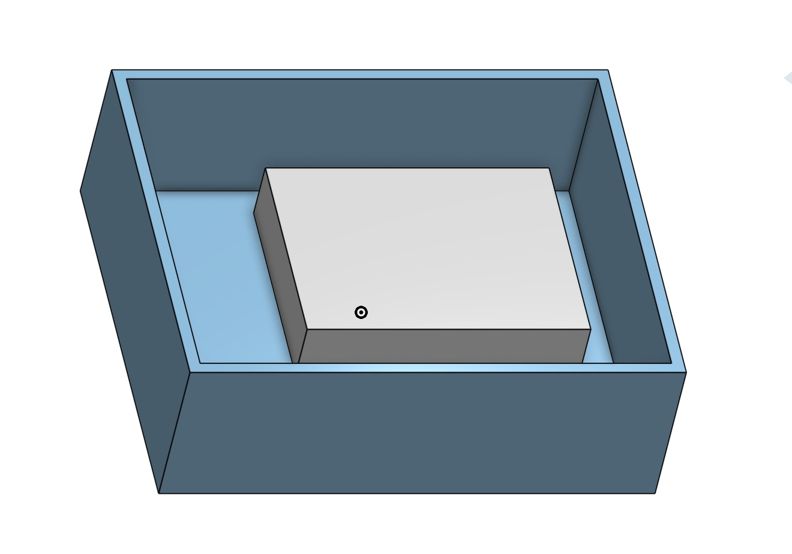
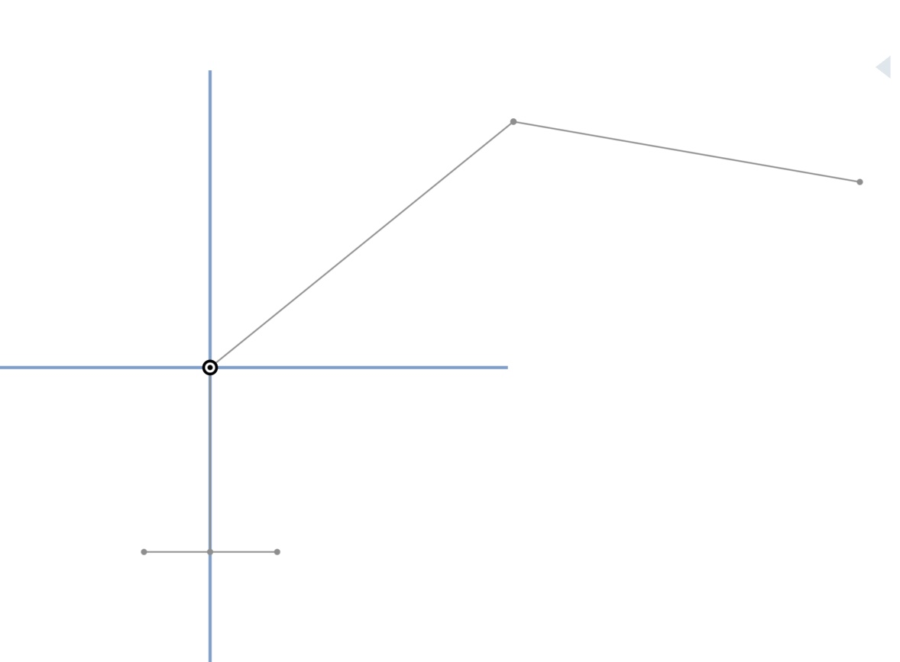
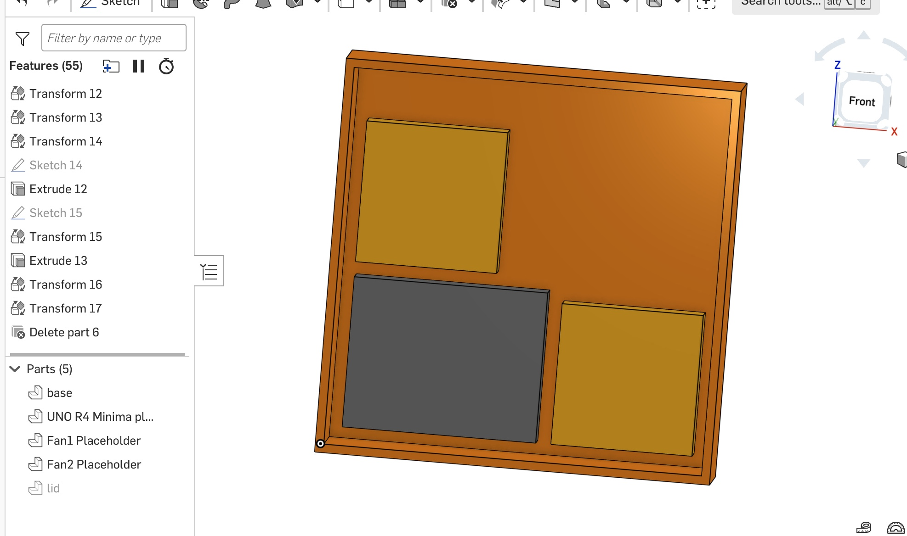
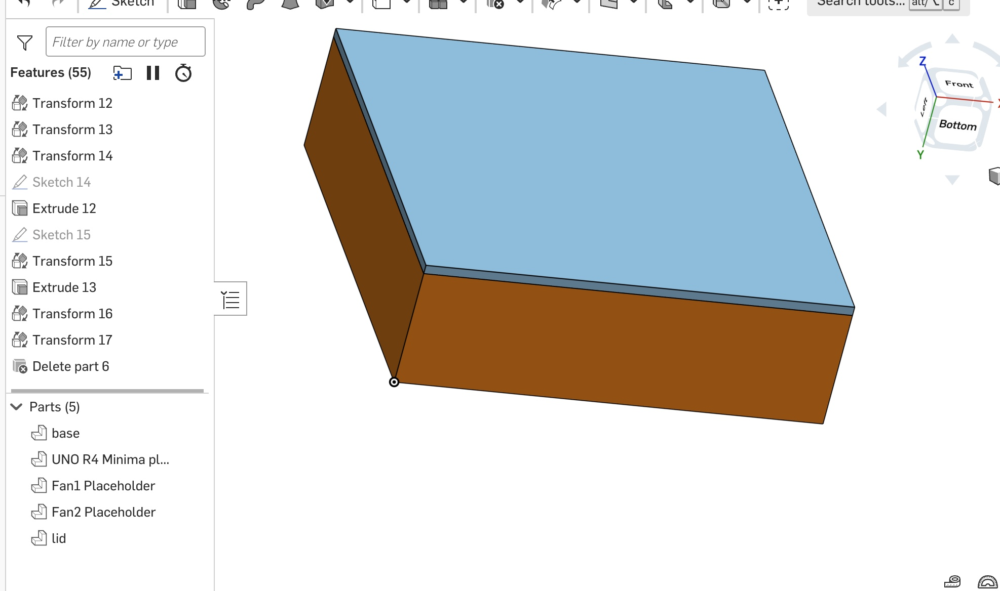
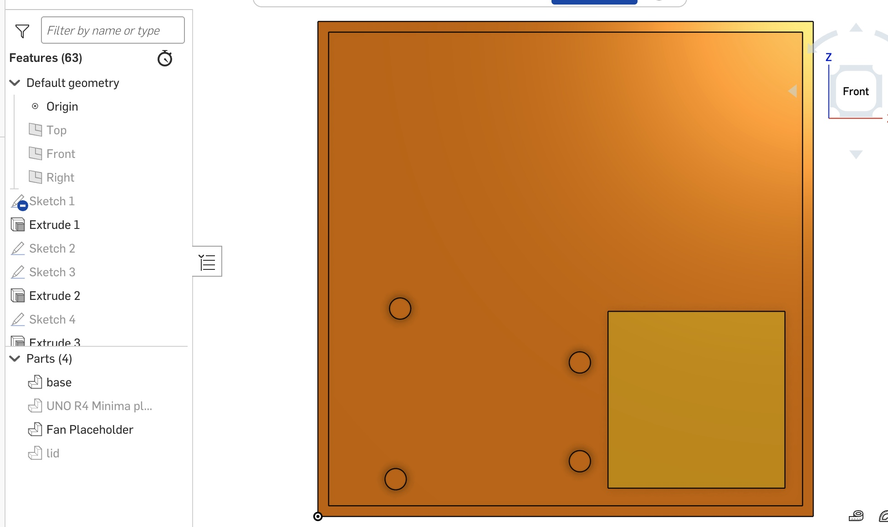

- [x] Add Scoch’s servo links
- [x] Confirm the base servo
- [x] Check Arduino fit in Onshape

| Component | Model | Dimensions (mm) | Mounting holes | Plug and wire space | Source | Status |
| --- | --- | --- | --- | --- | --- | --- |
| Controller board | Arduino UNO R4 Minima | TBD | TBD | USB-C plug and cable clearance TBD | Board drawing TBD | Proposed |
| Micro servo | MG90S | 22.8 × 12 × 28.1 | TBD | TBD | [RobotStore listing](https://www.robotstore.it/Servo-micro-TowerPro-MG90S) | Preliminary dimensions from Scoch’s notes |
| Standard servo | MG996R | 40.7 × 20.5 × 39.5 | TBD | TBD | [RobotStore listing](https://www.robotstore.it/Servo-digitale-standard-MG996R) | Preliminary dimensions from Scoch’s notes |
| Base servo | TD8320MG | 40.6 x 20.4 x 39mm | TBD | TBD | [RobotStore TD8320MG](https://www.robotstore.it/Servo-digitale-standard-TD8320MG-20KG-Waterproof) | Proposed by Scoch |
| Wiring board | Small breadboard with power rails or custom PCB | TBD | TBD | TBD | TBD | Choice TBD |
| Power supply | TBD | TBD | TBD | TBD | TBD | Model and placement TBD |
| Cooling fans (2) | 5015 centrifugal blower | 50 × 50 × 15 | TBD | Space for wires, air inlet, and outlet needed | [AliExpress listing](https://www.aliexpress.us/item/3256809779765997.html) | Proposed by Scoch; voltage option and mounting-hole spacing pending |

### Enclosure CAD progress - Irene

- USB-C side gap: 9.056 mm from the placeholder end face to the inside wall.
- Lid clearance: 22.000 mm from the placeholder top to the flat underside of the lid, before mounting posts.
- Pending: confirm the physical board and cable dimensions before adding mounting posts or the USB-C cutout.

### Follower Arm Side Layout - Irene

- Upper arm: 100 mm from shoulder to elbow.
- Forearm: 90 mm from elbow to gripper.
- Shoulder height: 47.275 mm above the sketched base top.
- Shoulder-to-gripper distance: 172.959 mm in the pose shown, or 190 mm with both links straight.
- Dimensions are provisional.

### Electronics update - Scoch

- Proposed base servo: TD8320MG.
- Servo body dimensions reported by Scoch: 40.6 × 20.4 × 39 mm.
- Reported mass: 62 g.
- Reported torque at 4.8 V: 17.2 kg·cm.
- Scoch proposed two brushless cooling fans, one on each side of the enclosure.
- Pending for CAD: servo mounting-hole dimensions, shaft position, and fan dimensions.

### Base and shoulder concept - Scoch

[Download Scoch's preliminary STL](./base-shoulder_sketch.stl)

- Scoch created a preliminary circular housing, top platform, and shoulder joint model.
- Intended motions include base rotation and shoulder lifting.
- Scoch intends the upper arm to attach to the horizontal shoulder tube.
- Pending: bearing arrangement, servo drive connections, arm attachment details, and connection to the electronics enclosure.
- Model is preliminary and has not been physically tested.

- Electronics enclosure outer footprint: 100 × 120 mm.
- Scoch's circular base is approximately 120 mm in diameter, assuming the STL units are millimeters.
- If centered above the enclosure, it would overhang the 100 mm side by approximately 10 mm on each side.
- Connection between the two housings is pending clarification with Scoch.

### Electronics enclosure v2 — Irene

- Enlarged enclosure to 140 × 140 × 40 mm.
- Wall and floor thickness: 3 mm.
- Nominal interior dimensions: 134 × 134 × 37 mm.
- Updated lid to match the enlarged enclosure.
- Layout includes an Arduino UNO R4 Minima placeholder and two fan placeholders.
- Arduino UNO R4 Minima placeholder: 68.58 x 53.34 x 15 mm (15mm height may change)
- Planned fans: 5 V blowers with dimensions of 50 × 50 × 15 mm each; voltage confirmed by Scoch.
- Fan placeholders represent rectangular envelopes rather than the exact curved housings.
- Spacing: 5 mm between wall and Arduino, 5 mm between wall and fan, 5.42 mm between Arduino and fan/s
- Pending: verified component clearances, mounting features, connector access, airflow openings, and wiring space.
- Design is only provisional and has not been physically tested.

### Base and shoulder concept v2 — Scoch

[View the second mechanism concept STL](./base-shoulder-concept-v2.stl)

- Scoch supplied an updated circular base and shoulder concept with an apparent upper-arm segment.
- Scoch confirmed that the circular mechanism sits above the electronics enclosure and the base rotates left/right.
- The shoulder is intended to move the arm up/down.
- Overall STL dimensions measure approximately 150 × 150 × 201 mm, assuming millimeter units.
- Circular base diameter measures approximately 150 mm; final dimensions await confirmation from Scoch.
- Centered on the 140 × 140 mm enclosure, this would produce approximately 5 mm of overhang on each side.
- Pending: motor and bearing arrangements, arm connections, attachment to the enclosure lid, and wire passage locations.
- Model remains a preliminary concept and has not been physically tested.

### Base, shoulder, and elbow concept v3 — Scoch

[View the third mechanism concept](./base-shoulder-concept-v3.stl)

- Updated concept includes an elbow joint and forearm segment.
- Gripper design is still pending.
- Overall model bounds are approximately 245 × 150 × 201 mm in the exported pose, assuming millimeter units.
- These overall dimensions include the extended arm; they are not the base diameter.
- Scoch proposed routing wires through an opening behind the shoulder.
- Exact attachment method, mounting dimensions, wire-opening size, and clearance during rotation remain unresolved.
- Model is preliminary and has not been physically tested.

### Arduino support posts draft - Irene

- Added four support posts to the electronics enclosure floor.
- Post centers follow the mounting-hole locations in the official Arduino UNO R4 Minima mechanical drawing.
- Draft post dimensions: 6 mm diameter × 5 mm height.
- Raised the Arduino placeholder to rest on the posts.
- Posts are currently solid; screw holes will be added after selecting screws or threaded inserts.
- Final fit, underside clearance, and access around nearby board components still require verification.
- Saved an Onshape version as a design checkpoint and shared the public document with Scoch for review.

[View the editable CAD source in Onshape](PASTE_YOUR_ONSHAPE_LINK_HERE)

Public viewing is available; editing requires permission.
